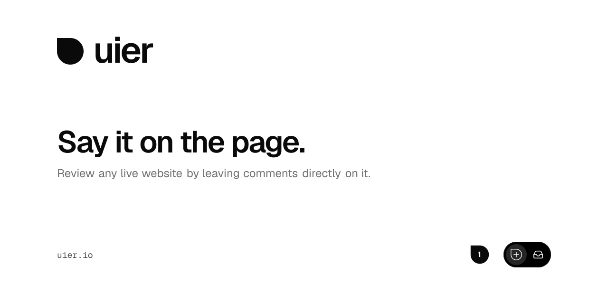

[](https://uier.io)

Review any live website by leaving comments directly on it. Pin feedback to an element or selected
text, discuss it with your team, and mark it done. Each comment keeps the browser and viewport it
was left from, with a screenshot when capture succeeds.

[Try uier](https://uier.io) · [Open the app](https://uier.io/app) · [How it works](https://uier.io/#how-it-works) · [Documentation](docs/README.md) · [Contribute](CONTRIBUTING.md)

## From feedback to a fix

| What you need | What uier keeps together |
| --- | --- |
| Point to the problem | Comments pinned to an element, selected text or an area of the page |
| Reproduce it | Page address, browser, viewport and a screenshot when capture succeeds |
| Review with other people | Workspaces, projects, teams, invitations and optional guest review links |
| Follow the work | Replies, assignees, unread activity and a list or board for feedback |
| Check a fix | Ready for review and verification by an eligible reviewer |
| Bring context to a coding tool | Copy issue and an authenticated [MCP connection](docs/mcp.md) |

## Pricing

Every feature available today is free and will stay free forever. If we introduce pricing, it will
apply only to new features users want.

## How it works

1. Create a project for your site and add the script from its install guide.
2. Share a review link. Reviewers leave comments on the page, with invited access or guest access.
3. Manage feedback in the toolbar inbox or the app's list and board. Assign threads, reply, and resolve them.

Workspace admins can share selected projects with [teams](docs/teams-and-access.md). Team grants
add to individual access; external reviewers sign in, while public guest links stay separate.

You can try the toolbar on [uier.io](https://uier.io) itself. Feedback on its public pages is public.
To add it to your own site, follow the [embedding guide](packages/toolbar/README.md#embedding).

Screenshots are decoded and re-encoded before storage to remove embedded metadata and extra
animation frames. They stay within 512 KB and 4096 px per side. Deleting feedback removes its image;
scheduled cleanup retries failed deletes once unreferenced images are older than an hour. See
[screenshot storage](docs/screenshot-storage.md) for the storage and cleanup contract.

The [desktop browser extension](docs/browser-extension.md) lets signed-in members review sites
without an embed. Version 0.1.2 is available in the Chrome Web Store and passed automatic-upgrade and
post-update acceptance in Chrome and Edge. See the [release receipts](docs/browser-extension-release.md)
for public visibility and the app installation-link rollout.

## Run locally

You need **Node.js 24** ([`.nvmrc`](.nvmrc)) and **pnpm through Corepack**. The repository pins the
pnpm version in [`package.json`](package.json).

```bash
git clone https://github.com/signalco-io/uier.git
cd uier
corepack enable
pnpm install
pnpm dev
```

Open [localhost:4004](http://localhost:4004). The toolbar builds and serves on port 4005 alongside
the website. Use `localhost` for the app so the development toolbar reaches the local API.

No database or email credentials are needed to get started. Local data stays in memory and resets
when the server restarts. On the [sign-in page](http://localhost:4004/app/sign-in), enter any email
address and use the sign-in link or code shown on the page.

For a persistent local database or optional rewrite suggestions, copy
[`apps/web/.env.example`](apps/web/.env.example) to `apps/web/.env.local` and set the relevant values.
See [local development and testing](docs/development.md) for the full setup and troubleshooting.

## Everyday commands

Run these from the repository root:

| Command | What it does |
| --- | --- |
| `pnpm dev` | Start the website and toolbar watch build |
| `pnpm typecheck` | Check TypeScript across the workspace |
| `pnpm build` | Build the toolbar and website for production |
| `pnpm test` | Run all API tests and essential browser journeys against the production build |
| `pnpm test:full` | Run the full desktop/mobile browser regression suite and API tests |

Before the first test run, install Chromium:

```bash
pnpm -C apps/web exec playwright install --with-deps chromium
```

Stop the dev server before testing, or choose another port with `PORT=4104 pnpm test`.
Tests start their own app server and local API stand-ins on `PORT + 1000` through `PORT + 5000`.
While implementing, use typecheck and [focused feature tests](docs/development.md#while-implementing).
Run the short `pnpm test` check before a code PR; full regressions are exceptional.
See the [testing guide](docs/development.md#test-categories) for categories and browser options.

## `/toolbar.js`

The website and toolbar support the latest two major versions of Chrome, Edge, Firefox and Safari,
including Safari on iOS. See the [browser policy](docs/development.md#browser-support).

The install guide offers the default `/toolbar.js` embed and **Pin this version** for HTML and
Next.js. The default follows new releases, with a five-minute browser cache and a one-hour CDN
cache. A pinned snippet uses `/toolbar/<sha256>.js`, a SHA-384 integrity check and anonymous CORS.
Its bytes stay unchanged and can be cached for one year.

**Caching and updates.** Pinned production bundles remain available and compatible with the review
API for one year after their last release as the current version. They get fixes only when you
update the snippet from the install guide. Production builds carry supported bundles forward;
preview and local pins belong to their own deployment. See [toolbar delivery](docs/api.md#toolbarjs)
for cache headers, retention and rollback details.

## Find your way around

This is a TypeScript monorepo using pnpm and Turborepo.

| Path | What lives here |
| --- | --- |
| [`apps/web`](apps/web) | Next.js website, signed-in app and APIs; deployed to Vercel |
| [`packages/toolbar`](packages/toolbar) | React review toolbar, bundled with tsup and isolated in a shadow DOM |
| [`packages/brand`](packages/brand) | Shared design tokens, logo components, copy and assets |
| [`infra`](infra) | Pulumi infrastructure for Vercel, Cloudflare, Azure Cosmos DB and Blob Storage |

The pnpm workspace includes `apps/*` and `packages/*`. Infrastructure has its own dependencies
and lockfile; install them separately only when working on infrastructure.

Production uses HTTPS cookies named `__Host-uier_visitor`, `__Host-uier_session`,
`__Host-uier_sign_in_request`, `__Host-uier_workspace` and `__Secure-uier_review_sso`.
Plain HTTP local runs keep the unprefixed names. See the [web guide](apps/web/AGENTS.md#page-security-and-cookie-migration)
for the bounded transition from old names. Cloudflare serves the apex A record, the `www` CNAME,
and a CAA record authorizing Vercel's certificate issuer, Let's Encrypt; see [operations](docs/operations.md).

## Go deeper

The [CI credential rollout](docs/ci-credential-rollout.md) tracks the staged move to protected
GitHub environments and production Cosmos DB identity access. Production and preview environments
use separate credentials. Builds run without deployment tokens, and the scheduled worker uses
its own OIDC data identity and explicit settings. Deployments run without human approval. Infrastructure and GitHub setup
are documented in [Infrastructure and operations](docs/operations.md#required-github-configuration).
Cosmos DB key authentication is disabled and both read/write account keys were regenerated.
Owner-managed Azure `CanNotDelete` locks cover resource group `uier-production8b2f56d6` and
Cosmos account `uierdbaba6cd56`, in addition to Pulumi protection; see the
[live verification record](docs/ci-credential-rollout.md#stage-5-activation-and-retirement-receipt--2-november-2026).


| Guide | Start here when you want to… |
| --- | --- |
| [Documentation index](docs/README.md) | Find a reference or implementation plan |
| [Toolbar guide](packages/toolbar/README.md) | Embed the toolbar and configure review modes |
| [Review workflow](docs/review-workflow.md) | Understand projects, permissions, screenshots and feedback recovery |
| [API reference](docs/api.md) | Work with review and comments APIs or toolbar delivery |
| [Coding tool access (MCP)](docs/mcp.md) | Connect a coding tool to feedback: sign in from Claude Code, or use an access token |
| [Connected services](docs/integrations.md) | Mirror feedback to Notion, GitHub, Linear or Azure DevOps, or send Slack notifications |
| [Integration setup guides](https://uier.io/integrations) · [Publication status](docs/integration-publication.md) | Connect a project or inspect provider directory review gates |
| [Brand guide](packages/brand/BRAND.md) · [Live brand page](https://uier.io/brand) | Work with the uier identity and shared tokens |
| [GitHub presence](docs/github-presence.md) | Update the repository details, social preview and company profile |
| [Infrastructure and operations](docs/operations.md) | Work on deployment, service checks or maintenance |
| [Screenshot storage](docs/screenshot-storage.md) | Private Blob images, direct access and migration |
| [Backups and restore](docs/backups-and-restore.md) | Recover accidental deletions and inspect the recorded restore drill |

## Removing abusive comments

Every account joins the shared uier project as a commenter. The encrypted staff allowlist grants
admin access automatically on sign-in and app requests; no invitation or manual project membership
is needed. Staff can see private app feedback as well as public comments.

1. Switch to **uier → uier.io public feedback** in the app.
2. Use **More from this author** to filter threads they opened or replied to.
3. Choose **Delete** for a thread and screenshot, or expand replies and choose **Delete reply**.
4. To add or remove staff, update the complete `uier:staffEmails` list with Pulumi's secret prompt,
   commit only encrypted configuration through a reviewed PR, and let CI deploy it.

The [moderation procedure](docs/operations.md#removing-abusive-comments) has the exact secret-config
command, deployment checks and the Cosmos DB fallback. Never delete comment-number sequences or
rate-limit counters. Personal workspaces and onboarding stay unchanged.

## Contributing

Bug reports, ideas and pull requests are welcome. [CONTRIBUTING.md](CONTRIBUTING.md) covers the
workflow, code conventions and checks. Coding agents should also read [AGENTS.md](AGENTS.md).
Report security problems through [SECURITY.md](SECURITY.md).

For product help, email [contact@signalco.io](mailto:contact@signalco.io). The
[support guide](SUPPORT.md) links to setup, troubleshooting, privacy and service status.

## License

The website and API in `apps/web`, and files without an explicit license, use
[AGPL-3.0-only](LICENSE). The toolbar, brand package and infrastructure use MIT, as declared in
their `package.json` files. [The open source page](https://uier.io/open-source) explains the licenses.

A [signalco](https://signalco.io) project.
