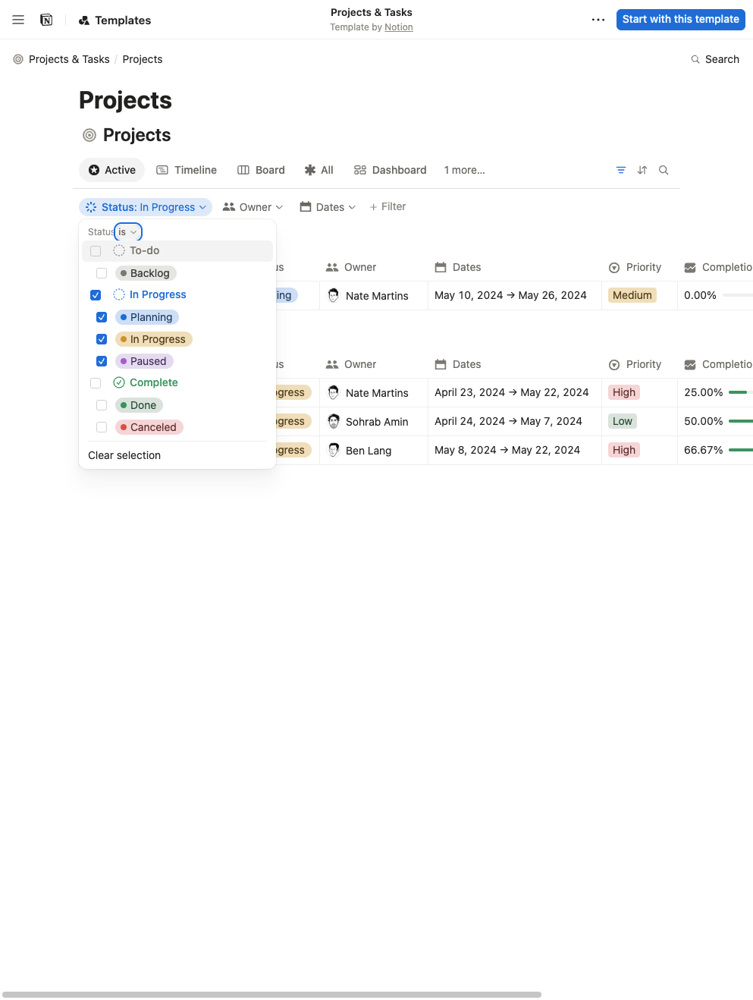
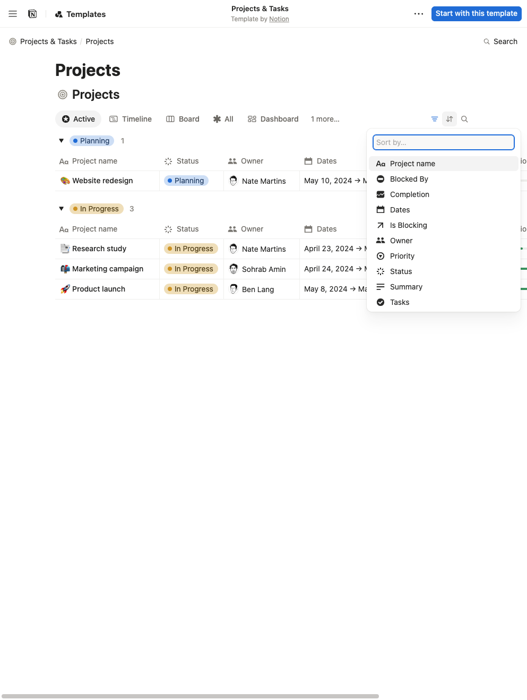
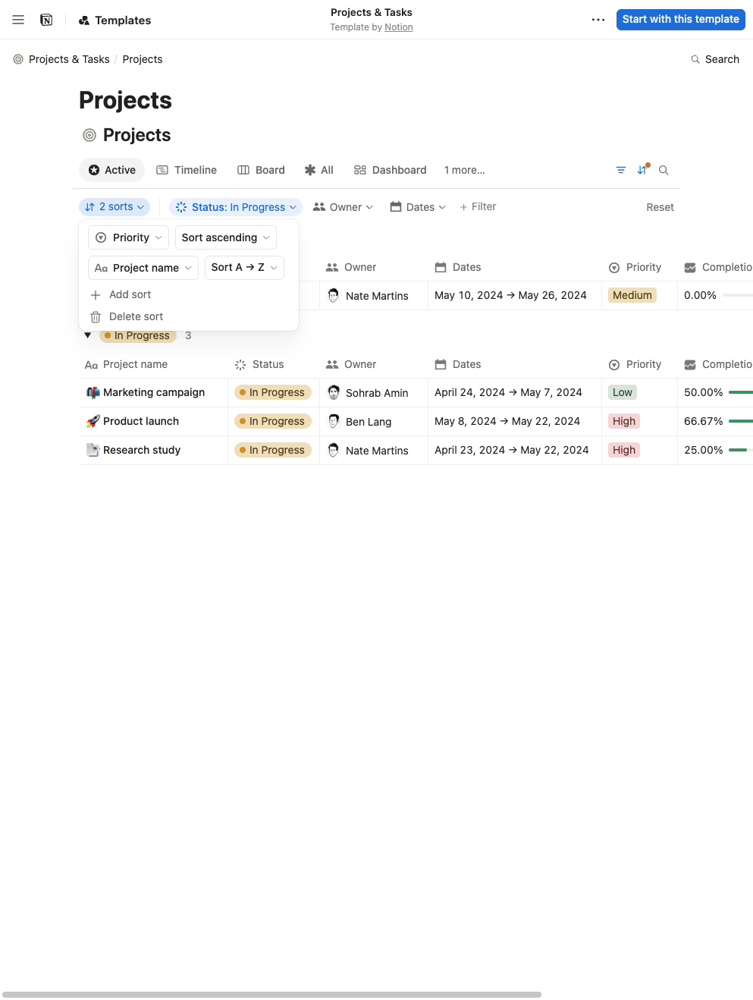
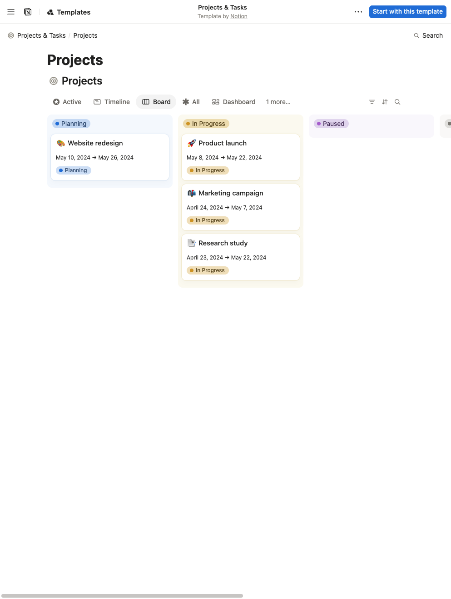
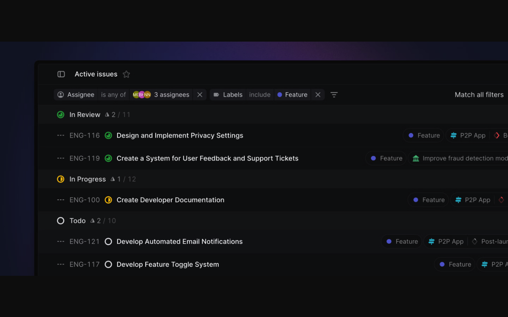
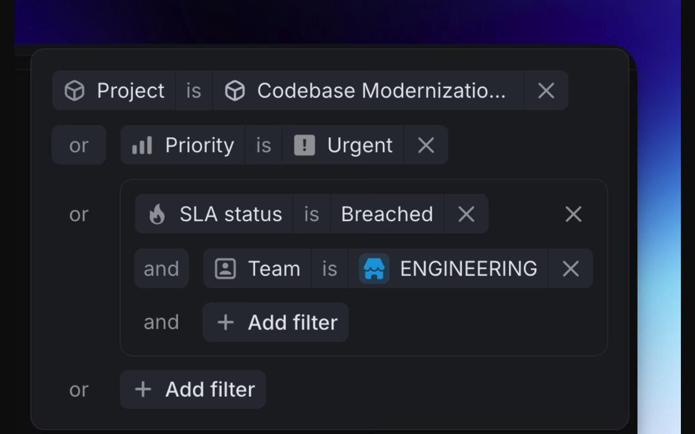
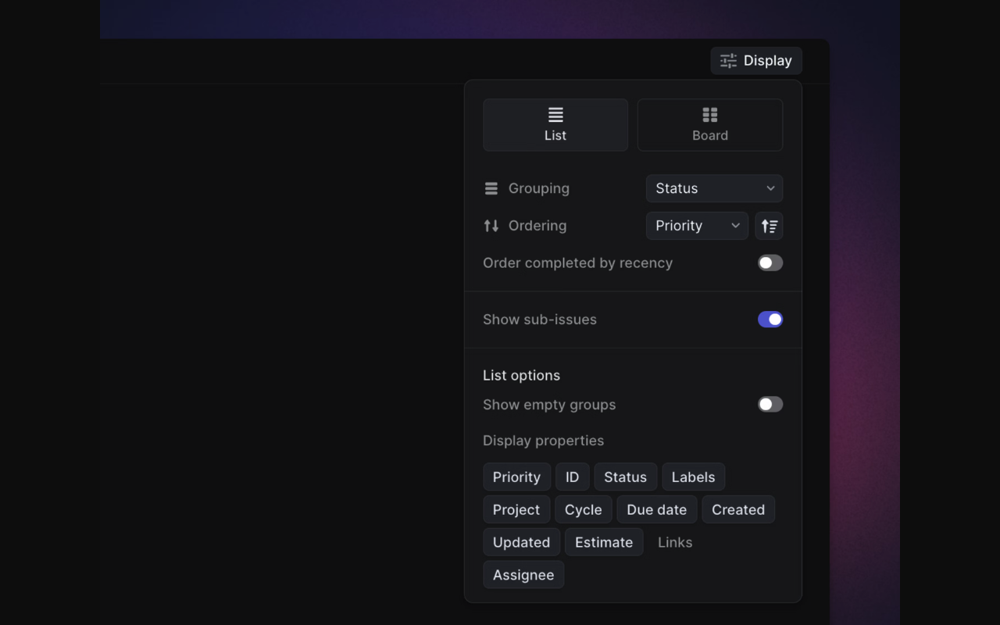

# Filtering and ordering references

Captured 11 November 2026 in Europe/Zagreb (10 November UTC).
Read alongside the [uier design guidelines](README.md).
The [interactive screenshot gallery](gallery.html) lets you switch between examples.

## Access and evidence quality

**Notion:** a real public database from Notion's own Projects & Tasks template opened without
login. Its list, board, filter and sort controls were exercised. Temporary visitor sorting was
reset afterward. The public visitor interface did not expose the advanced condition builder
or Save for everyone; those observations below come from official help, rather than live testing.

**Linear:** the connected account could find a private workspace view, but the browser session
required login. No private workspace content was captured or changed. The three Linear PNGs
below are browser screenshots of official product-example images linked from Linear's help
pages, opened directly for legibility. They are static reference examples, not screenshots of
a live board we interacted with. Current help text supplies the behavioral evidence; an
illustration may show an older version of the controls.

The PNGs are unmodified browser captures. Notion captures are 993 × 1318; Linear captures are
1280 × 800. Letterboxing and unused page space are retained. All examples are third-party
research references, not proposed uier styling or marketing assets.

## Notion: accessible list and board

- [Official template listing](https://www.notion.com/templates/notion-projects-and-tasks).
- [Public template home](https://notion.notion.site/Projects-Tasks-1ea72db0bc4f4c519e67ffed245560b2).
- [Projects list used for the captures](https://notion.notion.site/c6f0e5eea97c418fa88fbddc87fd8781?v=4f9a20c46742426ba7210a71d8998976).
- [Projects board used for the capture](https://notion.notion.site/c6f0e5eea97c418fa88fbddc87fd8781?v=97fc1d441eb747cca6f300078be5b5cc).

### Status condition

Filter reveals a row of property controls under the view tabs. Opening Status exposes an
operator and multi-select values. Selected conditions remain visible outside the popover.
For uier, keep this short path for everyday status/priority choices, with a visible query summary.

### Sort property picker

The Sort control opens a searchable list of properties. Property icons and names help explain
what can be ordered without a separate settings page.

### Multiple sorts

The visitor added Priority ascending followed by Project name A → Z. Both rows fit in one
popover; the outside chip summarizes two sorts and Reset is visible. This verifies multiple
rules and type-specific directions. Sort precedence and drag-handle reordering are additionally
described in the help source; the screenshots do not independently prove tie behavior.

### Board

The Board tab opens the same project's status columns. Filter and Sort remain in the familiar
header area. This demonstrates control placement on a real public board. Each Notion view has
its own settings; switching views is not evidence that a temporary query carried across.

### Additional behavior documented by Notion

[Views, filters and sorts](https://www.notion.com/help/views-filters-and-sorts) describes
grouped AND/OR conditions with up to three layers, moving a simple condition into the advanced
editor, sort priority through rule order, and explicit shared saving. Text and number fields
use their respective comparisons; select fields can follow their configured option order.
These support uier's proposed group editor and typed sort directions. Advanced editing and
shared saving still need authenticated interaction if a later implementation needs pixel-level
parity with those particular Notion states.

## Linear: official product examples

### Everyday filter chips

[Filters documentation](https://linear.app/docs/filters) shows property/operator/value chips,
multi-person selection, removal controls and a visible all-filters connector. It documents
filter search, type-dependent operators, immediate results, nested AND/OR groups and sharing
main filters through the URL. The document explicitly excludes display options and some quick
filters from that URL contract; do not assume every part of the view is shareable.

[Original official image](https://webassets.linear.app/images/ornj730p/production/26e1e266d76606fad8972baf4b57ed364aa2e4c1-2438x1126.png).

### Advanced groups

The same help page illustrates conditions combined with OR and a nested AND group. The
container boundary makes the grouping readable. Use that explicit structure when summarizing
logic that cannot be represented as a flat row of ANDed chips.

[Original official image](https://webassets.linear.app/images/ornj730p/production/158daf78ba2d520b7152a70f6758f1b39582f037-976x636.png).

### Ordering and display

[Display options](https://linear.app/docs/display-options) separates layout, grouping, order
and visible properties. The illustrated Ordering row has a property and direction control.
The text describes personal preferences, explicit workspace defaults and shared manual order.
It documents one ordering property with reversal; this research does **not** establish a
Notion-style multi-key sort editor in Linear.

[Original official image](https://webassets.linear.app/images/ornj730p/production/9723099db6c7913608fcdc59be40a27a33e528a4-1203x939.png).

[Custom views](https://linear.app/docs/custom-views) documents named durable queries and
sharing within existing access. [Board layout](https://linear.app/docs/board-layout) documents
list/board parity and shared ordering across those layouts, with workflow-ordered status
columns. Take the consistent query vocabulary and explicit save boundary; uier's existing
project-wide per-column sorts still need their own compatibility rules.

## Scope of the recommendation

The proposed uier interaction combines patterns observed above. It is not a claim of identical
behavior in both reference products. In particular, multiple ordered sort rules come from
Notion, while Linear supplies the compact filter presentation and explicit display separation.
No authenticated Linear board or authenticated Notion advanced editor was tested.
